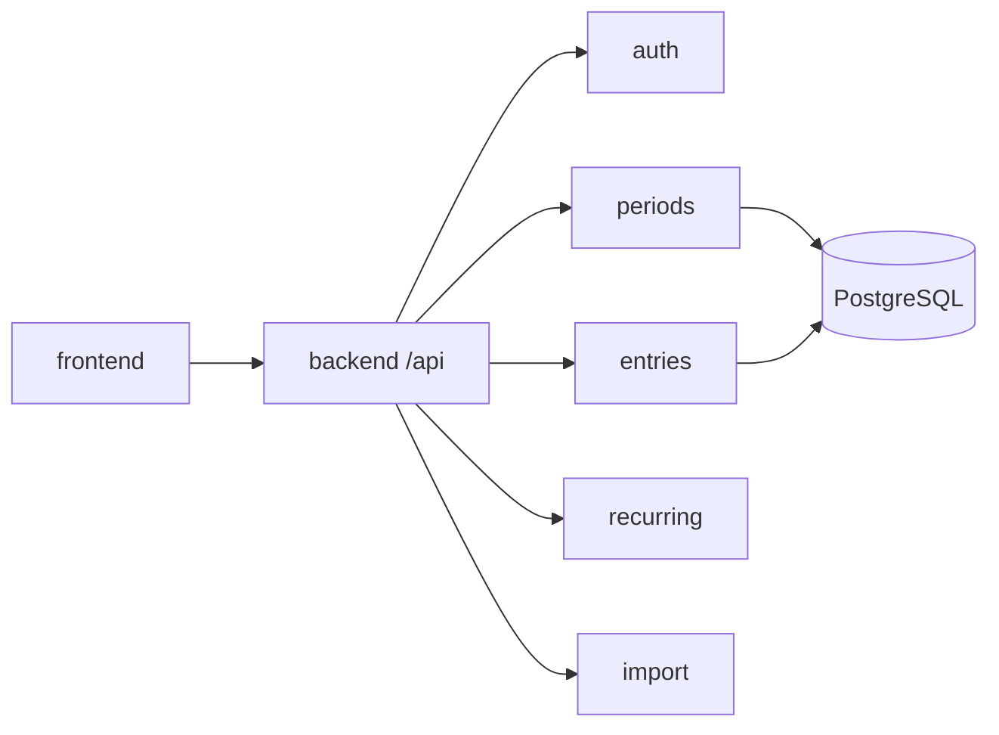

# Arquitetura — Finances

Espelha as técnicas dos monorepos **Giro Auto** / **Connect 3D Things**: npm workspaces, Nest modular + TypeORM com migrations indexadas, `@finances/shared` como contrato.

## Decisões

| Decisão | Escolha | Motivo |
|---|---|---|
| Layout | Monorepo | API + web compartilhando tipos |
| Backend | Nest modular monolith | Features isoladas em `modules/` |
| Persistência | TypeORM + migrations | Fonte de verdade; `synchronize: false` |
| Auth | JWT (issue #4) | Uso pessoal agora; multi-user depois |
| Mobile | Fora do MVP (#15) | Localhost web primeiro |
| Domínio | Modelado a partir da planilha Excel | Ver [`DOMAIN.md`](./DOMAIN.md) (#3) |
| Escopo usuário | Single-user + `userId` no MVP | `organizationId` no backlog (#14) |

## Portas locais

| Serviço | Porta | Nota |
|---|---|---|
| Postgres (Docker) | `5446` | Evita conflito com giro (`5444`) e connect (`5445`) |
| API Nest | `3002` | Prefixo global `/api` |
| Web Vite | `8081` | — |

## Estrutura

```
finances-api/
├── package.json                 # workspaces: backend, frontend, packages/*
├── docker-compose.yml           # PostgreSQL :5446
├── .env.example
├── backend/                     # NestJS (finances-api)
│   └── src/
│       ├── main.ts
│       ├── app.module.ts
│       ├── crosscutting/
│       │   ├── config/
│       │   └── database/        # data-source, entities/index, migrations/index
│       ├── modules/
│       │   └── health/
│       └── shared/
│           └── entities/base.entity.ts
├── frontend/                    # Vite + React + Tailwind
│   └── src/
│       ├── pages/
│       ├── components/
│       ├── lib/
│       └── paths.ts
└── packages/
    └── shared/                  # @finances/shared
        └── src/index.ts
```

## Contratos HTTP

Prefixo global: `/api`

- `GET /api/health` — público; `{ status, service, version, timestamp }`

Rascunho dos módulos de domínio (periods, entries, import, etc.): [`DOMAIN.md`](./DOMAIN.md#contratos-http-sugeridos-rascunho).

## Módulos de domínio (alvo)



| Módulo | Issue | Responsabilidade |
|---|---|---|
| `auth` / `users` | #4 | JWT + `userId` |
| `periods` | #5 | Meses + Caixa + summary |
| `accounts` / `parties` | #6 | Contas e pessoas |
| `entries` | #7–#8 | Lançamentos + Cartões derivado |
| `recurring` | #9 | Parcelas / recorrências |
| `import` | #11 | Excel → Period/Entry |
