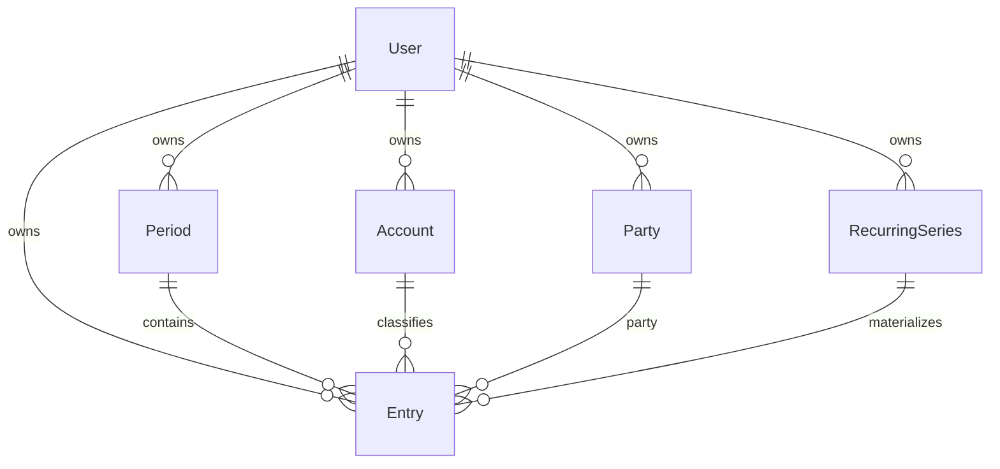

# Domínio — Finances

Modelo normalizado a partir da planilha **Financeiro - 2026.xlsx** (12 abas mensais). Objetivo: preservar o mapa mental do Excel e permitir CRUD + import sem planilha como fonte de verdade.

Escopo MVP: **uso pessoal / single-user** com `userId` em todas as entidades de domínio. Multi-tenant (`organizationId`) e mobile ficam no backlog (#14, #15).

## Visão da planilha

Cada aba (Janeiro…Dezembro) é um **período mensal** com blocos lado a lado:

| Bloco na planilha | Papel |
|---|---|
| **A Pagar** | Obrigações do mês (consórcio, DAS, seguro, linha **Cartões**, etc.) |
| **Caixa** | Orçamento / renda base do mês (ex.: 7500 → 8000) |
| **A receber** | Entradas de terceiros / rateios (pessoa + descrição + valor) |
| **Nubank** | Itens da fatura do cartão (`Geral`, compras, parcelas `n/m`) |
| **Fixos Nubank** | Assinaturas/recorrências no cartão (Prudential, Prime, Cursor…) |
| **Saídas (Dinheiro)** | Débitos em conta / caixa (não cartão) |
| **Outras Entradas** | Benefício, freelance, rendimentos, etc. |
| **Saldo** | Resultado do mês (célula derivada) |

A linha **Cartões** em A Pagar **não é um lançamento editável avulso**: é a soma de Nubank + Fixos Nubank.

Coluna **Sugestão IA** (apareceu em Maio) → fora do MVP (#16).

## Entidades

### User (prep. #4)

Autenticação JWT. Toda entidade de domínio carrega `userId` (FK). Queries sempre filtradas pelo usuário do token.

### Period

Representa uma aba/mês.

| Campo | Tipo | Notas |
|---|---|---|
| `id` | PK | |
| `userId` | FK | |
| `year` | int | ex.: 2026 |
| `month` | int | 1–12 |
| `caixaBudget` | decimal(12,2) | coluna Caixa |
| `notes` | text? | |
| `createdAt` / `updatedAt` | timestamp | `BaseEntity` |

UK: `(userId, year, month)`.

### Account

Conta financeira para classificar lançamentos.

| Campo | Tipo | Notas |
|---|---|---|
| `id` | PK | |
| `userId` | FK | |
| `name` | string | Nubank, C6, BB, Dinheiro… |
| `type` | varchar | `CARD` \| `CASH` \| `BANK` \| `OTHER` |
| `active` | boolean | default true |

Seed sugerido: Nubank (`CARD`), C6 (`CARD`), BB/Dinheiro (`CASH`/`BANK`).

### Party

Pessoa envolvida em **A receber** (e eventualmente pagamentos compartilhados).

| Campo | Tipo | Notas |
|---|---|---|
| `id` | PK | |
| `userId` | FK | |
| `name` | string | Gui, Udo, Vivi, Danilo… |
| `active` | boolean | |

### RecurringSeries

Série parcelada ou obrigação recorrente que materializa `Entry` mês a mês.

| Campo | Tipo | Notas |
|---|---|---|
| `id` | PK | |
| `userId` | FK | |
| `name` | string | Consórcio Imóvel, Vialaser… |
| `section` | varchar | section alvo do `Entry` gerado |
| `accountId` | FK? | |
| `defaultAmount` | decimal(12,2)? | pode variar (override no Entry) |
| `totalInstallments` | int? | null = recorrente sem fim conhecido |
| `nextInstallment` | int | próximo `current` a materializar |
| `dueRule` | string? | `dia 07`, `Recorrente`, livre |
| `status` | varchar | `ACTIVE` \| `COMPLETED` \| `CANCELLED` |

### Entry

Lançamento do período. Tipado por `section` (espelha os blocos).

| Campo | Tipo | Notas |
|---|---|---|
| `id` | PK | |
| `userId` | FK | |
| `periodId` | FK | |
| `section` | varchar | ver enum abaixo |
| `description` | string | |
| `amount` | decimal(12,2) | > 0 |
| `dueLabel` | string? | texto livre: `dia 07`, `59/80`, `Recorrente`, `Quitação` |
| `installmentCurrent` | int? | |
| `installmentTotal` | int? | |
| `accountId` | FK? | |
| `partyId` | FK? | típico em `RECEIVABLE` |
| `seriesId` | FK? | se veio de `RecurringSeries` |
| `notes` | text? | |
| `sortOrder` | int? | opcional, UI |

#### Sections

| `section` | Bloco planilha | Direção |
|---|---|---|
| `PAYABLE` | A Pagar (exceto linha Cartões) | saída |
| `RECEIVABLE` | A receber | entrada |
| `CARD_ITEM` | Nubank (Geral, compras, parcelas) | saída (via cartão) |
| `CARD_FIXED` | Fixos Nubank | saída (via cartão) |
| `CASH_OUT` | Saídas (Dinheiro) | saída |
| `OTHER_INCOME` | Outras Entradas | entrada |

Valores persistidos como **`varchar`** (sem ENUM PostgreSQL), tipados em `@finances/shared`.

## Relacionamentos



## Mapeamento planilha → modelo

| Célula / padrão Excel | Modelo |
|---|---|
| Aba “Outubro” + A1 data | `Period(year=2026, month=10)` |
| Caixa `D3=8000` | `Period.caixaBudget` |
| A Pagar: Flow / DAS / Consórcio… | `Entry(section=PAYABLE)` |
| A Pagar: linha **Cartões** + valor | **Derivado** — não persistir como Entry |
| A receber: Gui / Spotify / 40 | `Entry(section=RECEIVABLE, party=Gui)` |
| Nubank: Geral, Celular Novo `6/12` | `Entry(section=CARD_ITEM)` (+ parcelas) |
| Fixos Nubank: Amazon Prime | `Entry(section=CARD_FIXED)` |
| Saídas (Dinheiro) | `Entry(section=CASH_OUT)` |
| Outras Entradas: Benefício | `Entry(section=OTHER_INCOME)` |
| Parcela `20/208` recorrente | `RecurringSeries` + `Entry.seriesId` |
| Totais / Saldo | Calculados na API |

Linhas de cabeçalho (`A Pagar`, `Vencimento`, `Total`) e células de layout são **ignoradas** no import (#11).

## Fórmulas (espelhar Excel)

Observado na planilha (ex. Janeiro):

- `totalCard = sum(CARD_ITEM) + sum(CARD_FIXED)`
- `totalPayables = sum(PAYABLE) + totalCard`
- `totalReceivables = sum(RECEIVABLE)`
- `netObligations = totalPayables - totalReceivables`
- `monthBalance = caixaBudget - totalPayables + totalReceivables`

Conferência Janeiro: Caixa 7500, A pagar 8426.40, A receber 80 → saldo `-846.40`.

**Fora do total a pagar / saldo do topo** (mas visíveis no dashboard):

- `sum(CASH_OUT)` — saídas em dinheiro
- `sum(OTHER_INCOME)` — outras entradas  

Esses blocos alimentam o **Saldo** inferior da planilha (célula “Saldo” após cartão/fixos); no MVP a API pode expor:

```text
detailBalance = monthBalance - sum(CASH_OUT) + sum(OTHER_INCOME)
```

(ajustar na implementação do dashboard #10 se a planilha de algum mês divergir — documentar no PR da feature).

Totais **não** são persistidos (exceto cache futuro opcional). Sempre derivados.

## Contratos HTTP sugeridos (rascunho)

Prefixo: `/api`. Rotas de domínio exigem Bearer (#4). `GET /api/health` permanece público.

### Auth (#4)
- `POST /api/auth/login` → `{ access_token, user }`
- `GET /api/auth/me`

### Periods (#5)
- `GET /api/periods?year=`
- `GET /api/periods/:year/:month`
- `POST /api/periods`
- `PATCH /api/periods/:id`
- `GET /api/periods/:id/summary` — totais do mês

### Accounts & Parties (#6)
- CRUD ` /api/accounts`
- CRUD ` /api/parties`

### Entries (#7–#8)
- `GET /api/periods/:id/entries?section=`
- `POST /api/entries`
- `PATCH /api/entries/:id`
- `DELETE /api/entries/:id`

### Recurring (#9)
- CRUD `/api/recurring-series`
- `POST /api/periods/:id/materialize-series` — gera Entries do mês

### Import (#11)
- `POST /api/import/xlsx` — dry-run + commit

### Annual (#12)
- `GET /api/periods/summary?year=2026`

## Decisões explícitas

| Tema | Decisão |
|---|---|
| Mobile | Fora do MVP (#15) |
| Multi-user / família | Backlog via `organizationId` (#14); MVP só `userId` |
| Linha Cartões | Sempre **derivada** |
| Moeda | BRL; `decimal` na API; formatação pt-BR na UI |
| Status / sections | `varchar` + tipos em `@finances/shared` |
| Sugestões IA | Backlog (#16) |
| Import Excel | Heurísticas em `docs/IMPORT.md` na issue #11 |

## Ordem de implementação sugerida

1. #4 Auth + `userId`
2. #5 Period + summary stub
3. #6 Account / Party
4. #7 Entries (PAYABLE, RECEIVABLE, CASH_OUT, OTHER_INCOME)
5. #8 CARD_ITEM / CARD_FIXED + Cartões derivado
6. #9 RecurringSeries
7. #10 Dashboard
8. #11 Import xlsx
9. #12 Resumo anual
